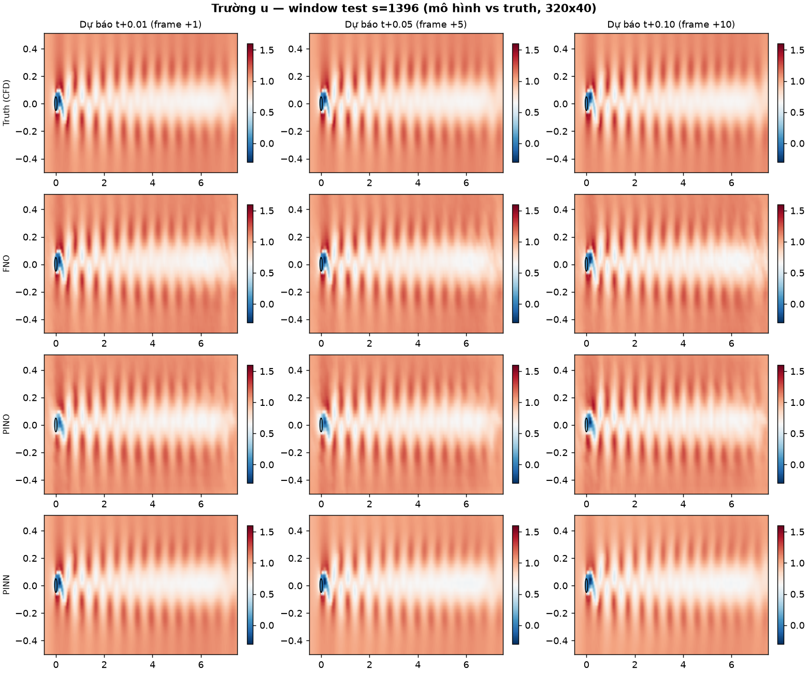
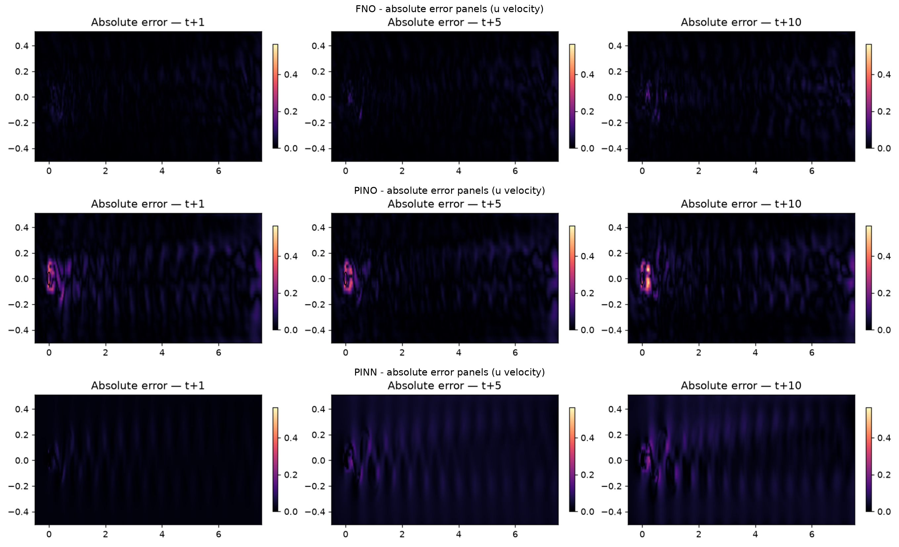
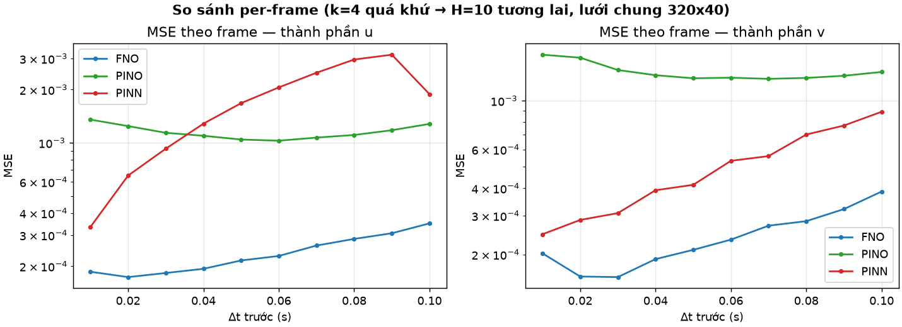
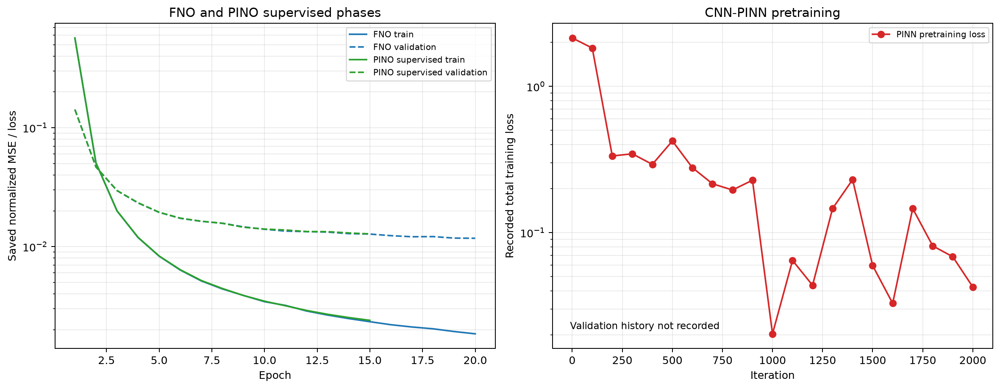

# Cylinder Flow Forecasting: CNN-PINN, FNO, and PINO

This project compares three neural approaches for forecasting two-dimensional
flow around a cylinder from CFD velocity fields:

- **CNN-enhanced PINN** — a fully convolutional residual U-Net. It uses spatial
  patches with context halos, adaptive boundary/physics loss weighting, and
  per-test-window physics fine-tuning.
- **FNO** — a Fourier Neural Operator with four spectral blocks (width 24,
  modes 12 × 20), trained with supervised data loss.
- **PINO** — the same FNO backbone, first supervised-pretrained and then
  fine-tuned with a vorticity-transport residual and a divergence penalty.

All three predict ten future frames directly from four input frames. The
reported comparison uses the same held-out temporal windows for all models.

## Dataset and Data Availability

This project uses CFD data associated with RealPDEBench. The original dataset
is **not included in this GitHub repository** because of repository size and
data distribution considerations. Users must obtain the data from its original
source:

[RealPDEBench — Official Dataset Source](https://realpdebench.github.io/)

The official site describes the benchmark and points to dataset-specific
scenario pages for formats and access instructions. This repository does not
provide a direct download URL. Consult the selected dataset's original
documentation and metadata for its authoritative description, attribution,
citation requirements, and license. No dataset authorship or license terms
are asserted by this project.

### Obtaining and Preparing the Data

1. Follow the official RealPDEBench site to the relevant CFD/cylinder dataset
   and obtain the files using the instructions published there.
2. The current loader expects an externally obtained VTK XML ImageData file
   named `cylinder2d.vti` at
   `D:\CFD_cylinder_2d\cylinder2d_vti\cylinder2d.vti`. The file is not tracked
   by Git. The loader reads point-data arrays named `u` and `v`, reshaped to
   `(1501, 80, 640)`.
3. The loader creates `output\cache\uv_full.npz` and
   `output\cache\uv_ds.npz` locally from the VTI file. Training and evaluation
   also expect `output\cylinder_mask.npy`, a Boolean `(80, 640)` cylinder mask.
   The source tree currently has no standalone preprocessing command for this
   mask. For a dataset matching the loader's stated layout, it can be prepared
   from nodes whose two velocity components are exactly zero in every frame:

   ```python
   from pathlib import Path

   import numpy as np
   import pyvista as pv

   root = Path(r"D:\CFD_cylinder_2d")
   mesh = pv.read(root / "cylinder2d_vti" / "cylinder2d.vti")
   u = np.asarray(mesh.point_data["u"], dtype=np.float32).reshape(1501, 80, 640)
   v = np.asarray(mesh.point_data["v"], dtype=np.float32).reshape(1501, 80, 640)
   mask = np.all((u == 0) & (v == 0), axis=0)
   if mask.shape != (80, 640) or int(mask.sum()) != 60:
       raise ValueError("The data do not match the cylinder-mask layout expected by this project.")

   output = root / "output"
   output.mkdir(exist_ok=True)
   np.save(output / "cylinder_mask.npy", mask)
   ```

The data loader currently hard-codes the Windows project root in
`data_common.py`. To use another location, configure `ROOT` and `VTI` there
before running the scripts. A portable configuration for a future revision
would derive the root from the source file, for example
`ROOT = os.path.dirname(os.path.abspath(__file__))`, and build the VTI path
relative to it. The training code has not been changed as part of this
documentation update.

Download and prepare the original dataset separately before running any
preprocessing, training, or evaluation. The VTI and generated arrays/caches
are external or temporary data; do not commit them, upload them to this
repository, or use Git LFS for them.

## Experimental Setup

- **Fields and grid:** horizontal and vertical velocity (`u`, `v`); source
  grid 640 × 80, with FNO/PINO evaluated at a 320 × 40 grid.
- **Temporal task:** four past frames → ten future frames, direct multi-frame
  prediction with a 0.01 s frame interval.
- **Split:** deterministic, purged temporal 70/15/15 split. The reported run
  uses 970 training, 208 validation, and 181 test windows; a 14-frame purge
  prevents input/target overlap across split boundaries.
- **Comparison:** common 320 × 40 grid and same test windows; the full-resolution
  PINN output is downsampled by two in each spatial dimension. Overall errors
  are reported in physical velocity units.
- **Physics setting:** the scripts use `nu ≈ 1.220 × 10⁻³` (based on the
  repository's configured `U`, `D`, and implied `Re`).

## Quantitative Results

The following values are from the existing evaluation report and are not
recomputed by this README update. Lower MSE/RMSE/MAE is better; higher R² is
better.

| Model | MSE | RMSE | MAE | R² (u) | R² (v) | Pooled R² |
|---|---:|---:|---:|---:|---:|---:|
| FNO | 2.3988e-04 | 0.0155 | 0.0106 | 0.991 | 0.991 | 0.999 |
| PINO | 1.2547e-03 | 0.0354 | 0.0200 | 0.956 | 0.950 | 0.995 |
| CNN-PINN | 1.1252e-03 | 0.0335 | 0.0241 | 0.933 | 0.981 | 0.996 |

Per-horizon pooled MSE (mean of `u` and `v`, common 320 × 40 grid):

| Horizon (s) | FNO | PINO | CNN-PINN |
|---:|---:|---:|---:|
| 0.01 | 1.9418e-04 | 1.4841e-03 | 2.9026e-04 |
| 0.02 | 1.6614e-04 | 1.4042e-03 | 4.6919e-04 |
| 0.03 | 1.7041e-04 | 1.2577e-03 | 6.1660e-04 |
| 0.04 | 1.9188e-04 | 1.1996e-03 | 8.3685e-04 |
| 0.05 | 2.1267e-04 | 1.1528e-03 | 1.0448e-03 |
| 0.06 | 2.3101e-04 | 1.1488e-03 | 1.2943e-03 |
| 0.07 | 2.6595e-04 | 1.1623e-03 | 1.5244e-03 |
| 0.08 | 2.8437e-04 | 1.1871e-03 | 1.8293e-03 |
| 0.09 | 3.1435e-04 | 1.2368e-03 | 1.9602e-03 |
| 0.10 | 3.6780e-04 | 1.3139e-03 | 1.3856e-03 |

## Result Visualizations

The snapshot figure compares CFD ground truth with all three predictions for
the same test window and three forecast horizons:



Absolute-error panels show the `u`-velocity error at three forecast horizons
for each model:



Per-frame error and training/validation histories are shown below. The PINN
training log records sampled pretraining losses but does **not** record a
validation history; the training figure marks that missing curve rather than
implying one exists. PINO's plotted supervised phase is its pretraining phase.





The figures are result visualizations only. No model was retrained and no
experimental metric was changed to prepare this README.

## Installation and Usage

Install Python dependencies in an environment compatible with your PyTorch
installation. Choose the PyTorch package appropriate for your platform and
hardware:

```powershell
python -m pip install numpy matplotlib pyvista torch
```

After obtaining and preparing the external dataset as described above, run
from the project root:

```powershell
python fno.py
python pino.py
python pinn.py
python evaluate.py
```

The evaluation script requires prediction files from all three models. It
writes the quantitative report and comparison visualizations under
`results\comparison\`. The current scripts use the existing configuration in
`data_common.py`; training defaults and runtime depend on the machine and
dataset.

## Repository Structure

```text
.
├── README.md
├── .gitignore
├── data_common.py             # Shared data paths, loader, splits, and physics helpers
├── fno.py                     # Fourier Neural Operator
├── pinn.py                    # CNN-enhanced PINN
├── pino.py                    # Physics-Informed Neural Operator
├── evaluate.py                # Common test-set evaluation and figures
├── run_all.ps1                # Existing Windows orchestration script
├── results/
│   └── comparison/            # README/evaluation figures and report
├── cylinder2d_vti/            # Local external dataset only; not tracked
└── output/                    # Local caches and generated intermediates; not tracked
```

The `cylinder2d_vti/` and `output/` entries above are local working directories,
not repository-distributed data. Model checkpoints, prediction arrays, caches,
and other generated intermediates are excluded by `.gitignore`.

## References and Acknowledgements

- **Dataset:** RealPDEBench. See the [official source](https://realpdebench.github.io/)
  and the selected dataset's own metadata for the correct dataset citation,
  attribution, and license.
- **PINN background:** Raissi, Perdikaris, and Karniadakis, “Physics-informed
  neural networks: A deep learning framework for solving forward and inverse
  problems involving nonlinear partial differential equations,” *Journal of
  Computational Physics*, 2019.
- **FNO background:** Li et al., “Fourier Neural Operator for Parametric
  Partial Differential Equations,” ICLR, 2021.
- **PINO background:** Li et al., “Physics-Informed Neural Operator for
  Learning Partial Differential Equations,” 2021.

The dataset is not created by this project. Please follow RealPDEBench's
original metadata for acknowledgements and citation requirements.
